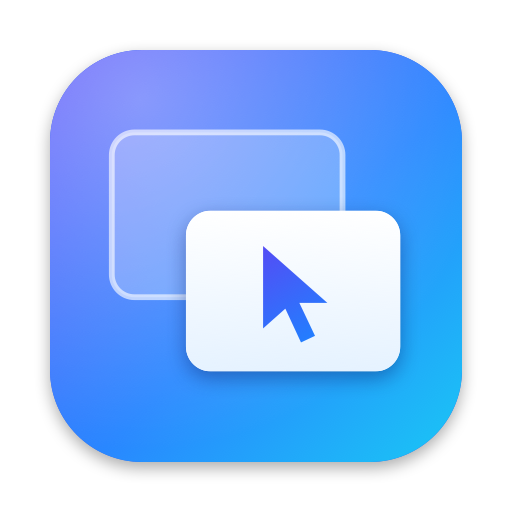
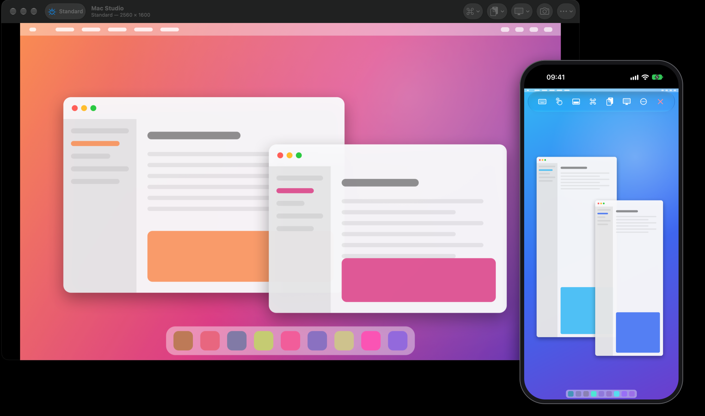
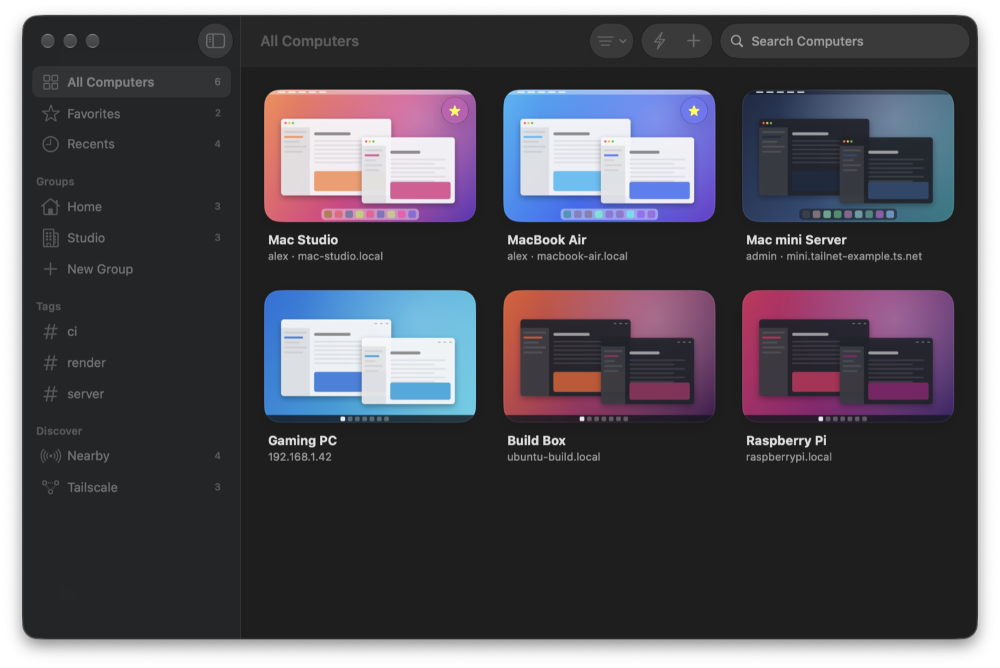
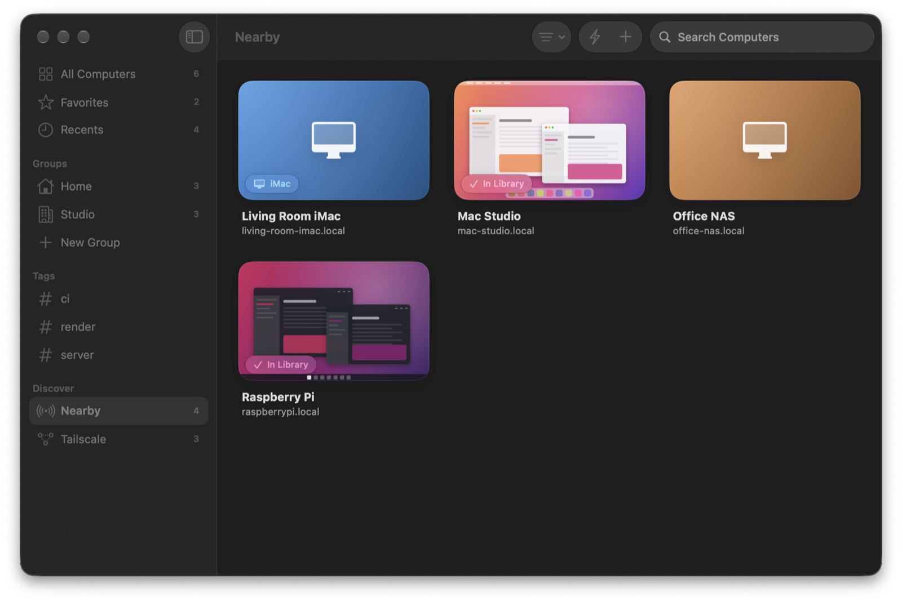
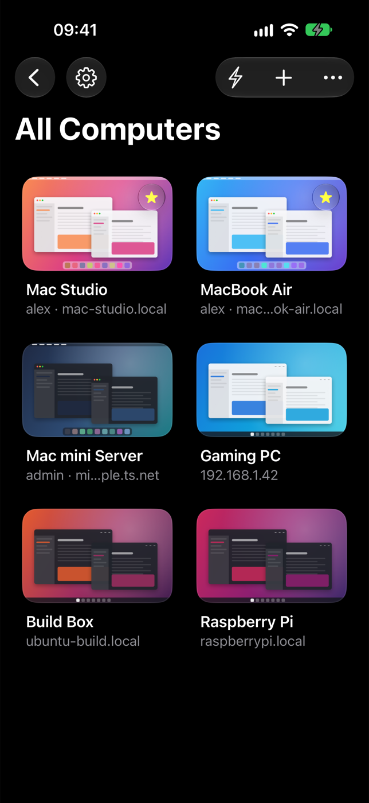
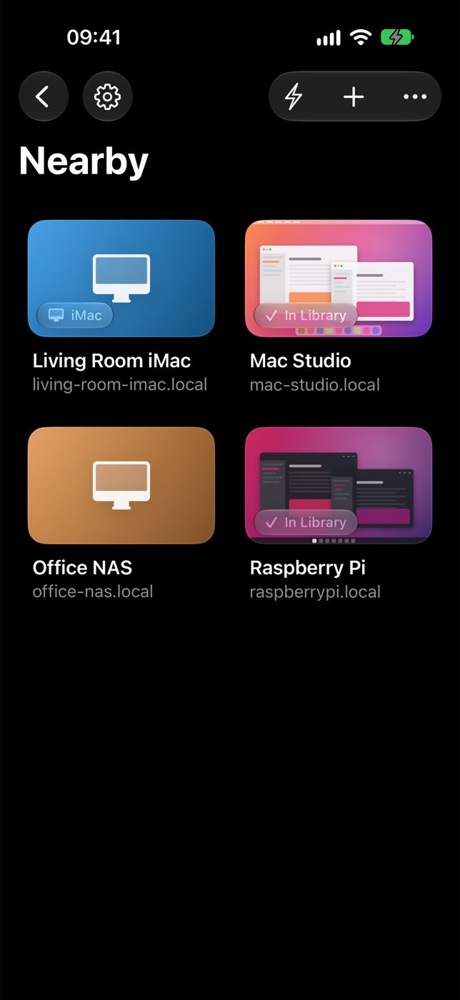
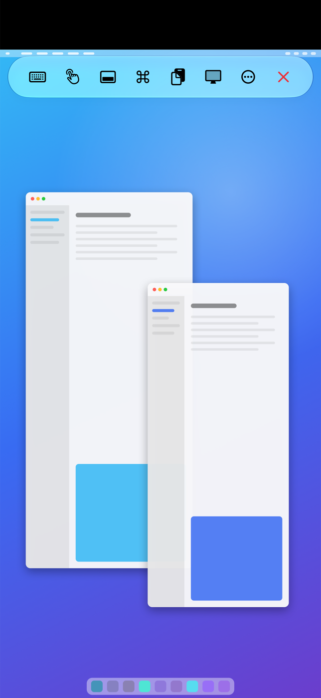

<div align="center">



# OpenScreens

**Remote desktop for Mac, iPhone and iPad. Free and open source.**

Control a Mac the way Apple's own Screen Sharing does — High Performance mode,
sound and a desktop that resizes to fit included — and Linux, Windows and
Raspberry Pi computers through VNC.

[](https://github.com/burakgon/OpenScreens/actions/workflows/ci.yml)
[](https://github.com/burakgon/OpenScreens/releases/latest)


[](LICENSE)



</div>

## What it controls

| Computer | What OpenScreens speaks to it |
|---|---|
| **Mac** | Apple's Screen Sharing, the way Apple's own app does: High Performance mode with sound, Standard and Full Quality. |
| **Linux** | VNC. TigerVNC, x11vnc and wayvnc each run for real in the [lab](scripts/compat-lab) that comes with the project, and sessions are tested against all three. |
| **Raspberry Pi** | VNC as Raspberry Pi OS turns it on, signed in with your user name and password on the Pi. Tried against the same server set up the same way, and not yet on a Pi itself. |
| **Windows** | VNC, through a server installed there: TightVNC, UltraVNC or RealVNC Server. Not tried against those yet. RDP is not spoken: [say if you want it](https://github.com/burakgon/OpenScreens/issues/2). |

The app itself runs on Mac, iPhone and iPad.
[Setting each of these up](#windows-linux-and-raspberry-pi) is a few lines,
further down. A session with any of them can go through an SSH tunnel or
Tailscale.

## Why not the Screen Sharing app that comes with a Mac?

Between two Macs it is very good, and OpenScreens speaks the same protocol
to the same Macs. What OpenScreens adds:

- **iPhone and iPad.** Apple makes no Screen Sharing app for them. Here
  High Performance mode, with sound and a desktop made for the screen in
  your hand, works from a phone.
- **Computers that are not Macs.** Linux, Windows and Raspberry Pi through
  the VNC servers people actually run, signed in to the way those servers
  ask: [see below](#windows-linux-and-raspberry-pi).
- **A way in from anywhere.** Your Tailscale devices listed beside your
  library, and SSH tunnels built in, keys and all.
- **Files without screen sharing.** An SFTP browser for anything that runs
  SSH.
- **A library.** Groups, tags, previews and search, the same on every
  device through iCloud.
- **The source.** MIT licensed. No account to make, nothing to pay for and
  no analytics.

## What it does

**The picture**

- **High Performance mode** for Apple silicon Macs: HEVC video at up to 60
  frames a second, the remote Mac's sound, and a desktop created at the size
  of your window or screen. A phone held upright gets an upright desktop
  made for a phone, with text large enough to read and no more pixels than
  it can show; ask for more space when you want the room instead.
- **One display, all of them side by side, or two virtual displays** of your
  own, which share the window: beside each other when it is wide, one above
  the other on a phone held upright.
- **Standard and Full Quality** modes for every Mac, and for Windows, Linux
  and Raspberry Pi computers running a VNC server. A VNC server with a
  desktop of its own, such as TigerVNC, makes it the size of your window
  or screen as well.
- Zoom, pan, fit, fill and actual size. A reconnect picks up where it left
  off, with the last picture still faintly there.

**The keyboard and pointer**

- **What you type is what arrives**, whichever keyboard layouts the two
  computers use. On a Turkish, German or French keyboard the symbols behind
  Option — `@ # { } [ ] \` — come out as those symbols, dead keys combine,
  and shortcuts land on the key they name. Prefer the remote layout to
  decide? Send key positions instead, as Apple's client does.
- Keystrokes to a Mac are encrypted, even in a session whose picture is not.
- On iPhone and iPad: touch the thing you want to click, or use the screen as
  a trackpad. Two-finger scrolling with momentum, pinch to zoom, right-click
  and drag gestures, a key bar for modifiers, arrows and function keys, and
  full support for hardware keyboards, trackpads, mice and Apple Pencil.
- The picture has the screen to itself. The controls stand beside it where
  the screen has a strip to spare — the cover display of an iPhone Duo, any
  iPhone on its side — and elsewhere go away to a small handle the moment
  you touch the remote screen. A keyboard slides the picture up instead of
  shrinking it.
- Shortcuts in one tap — Mission Control, Spotlight, Control-Alt-Delete — and
  your own. Type Text sends a whole paragraph as keystrokes.

**Getting there**

- **Nearby** finds the computers on your network that offer screen sharing.
- **Tailscale** lists the computers in your tailnet, so they are one tap away
  from anywhere.
- **SSH tunnels** carry the whole connection inside SSH, with a password or a
  key. A server's key is shown before it is trusted, and a changed key stops
  the connection.
- **Wake-on-LAN** wakes a sleeping computer first (from the Mac app).
- `vnc://` links, a menu bar item on the Mac, and actions for Shortcuts.

**Your library**

- Groups, tags, favourites, recents and search, as a grid of screen previews
  or a list.
- **A computer you get into is kept.** Connect to one from Nearby or by its
  address and it joins the library the first time you are in, so it is
  waiting the next time the app opens. One you never got into is not kept.
- **iCloud sync** keeps it the same on every device. Passwords stay in your
  keychain and never go into the library file, iCloud's copy of it or a
  backup.
- Daily automatic backups, export and import.
- Lock the app behind Face ID or Touch ID.

**While connected**

- Shared clipboard. Curtain mode, which blanks the remote Mac's own screen
  while you work. Observe only. Lock the remote Mac when you disconnect.
- **Drag and drop with a Mac.** Drop files on the picture and they are
  copied into whatever they land on there, a folder or the desktop. Drag
  files on the Mac to the top of the picture to copy them back. Or choose
  **Send Files** and they go to the Mac's Downloads folder. Nothing to set
  up: it uses the Screen Sharing connection itself.
- **Files.** Browse the computer's folders and copy files and whole folders
  in either direction, over SFTP, with nothing to install on the other end
  beyond Remote Login or an SSH server.
- Live statistics: mode, size, frame rate, bitrate, loss, and how the
  connection is protected.

**A folding iPhone, and a screen plugged into one**

- **The desktop follows how the phone is held.** Folded, half-open and open
  are three different screens, and a fold passes the window through a run of
  sizes on the way between them. The request for a desktop to match waits
  until the size has stopped changing, so one fold asks the Mac once instead
  of at every step through it, and the new picture dissolves in rather than
  flashing black.
- **Stood up half-open, the phone is a laptop.** With the fold across the
  screen, the desktop is made for the half standing up and fills it, and the
  half lying down becomes a MacBook's keyboard and trackpad, there the moment
  the phone is folded and before the connection is made. The keys are held
  for as long as they are touched, so a shortcut is one too: hold ⌘ and tap
  C, or hold ⌘ and step through the app switcher with Tab. A modifier tapped
  on its own waits for the next key, and tapped twice stays on. With no
  function row, fn and the number row give Escape and F1 to F12.
- **All of the lower half is the trackpad**, edge to edge, though only its
  middle is drawn as one. One finger moves and clicks, two scroll and
  right-click, a pinch zooms, three tap to look a word up, and three or four
  swipe for Mission Control, App Exposé and Spaces.
- **Any other way it is held**, the row of modifiers, Esc, Tab and the arrows
  can be brought out from the toolbar.
- **Each posture can keep its own answers** — how touches drive the pointer,
  whether the desktop is sized for the screen or for any Mac window, and
  whether the row of keys is out — under **Folding** in a computer's
  settings. They are laid over the computer's own settings instead of
  changing them, so unfolding cannot leave the folded choices saved behind.
  Nothing is decided for you until you set it, or press the one button that
  fills in what is suggested. Stood up as a laptop, the keyboard comes out
  whatever the row of keys is set to.
- **Three-finger swipes can drive the Mac** instead of moving the picture:
  up for Mission Control, down for App Exposé, sideways for the next or
  previous Space. Off until it is turned on.
- **A display on the phone's cable takes the desktop** while a computer is
  open, at that display's size, with the pointer drawn on it. The phone
  becomes the trackpad, as wide as it is held, and its own keyboard is a tap
  away for typing, with the row of modifiers, Esc, Tab and the arrows above
  it. What has to be read or answered — signing in, a computer that could
  not be reached — stays on the phone, which is the half in your hand. On the
  library the display shows the phone, so you can see what you are choosing.

<sub>Tried on an iPhone Duo, folded, half-open and stood up like a laptop, and
with a display on the end of a cable. Going from the inner screen to the
outer one with a display attached has once closed the app, which has not been
seen again or explained yet, and a keyboard paired with the phone has not
been tried with a display attached. The hinge and the display are both read
from the system, and so want a newer iOS than the app asks for: the hinge is
iOS 27.1, and iOS 27 to ask a display to be the app's own rather than a mirror
of the phone. Below those the phone is taken to be open and a display mirrors
it, as it does today. How long the Mac is left to settle before a new desktop is asked for
has been watched, not measured, and the dissolve covers Standard mode only —
High Performance still redraws across a resize.</sub>

**Keeping up to date**

- **The Mac app updates itself.** A new version is announced above the
  library, with what is in it. One click downloads it, checks it against the
  project's signing key, installs it and opens the app again. If a session
  is open by then, you are asked before the app closes.
- **What is new, after an update.** On Mac, iPhone and iPad the first launch
  after an update says what changed.

## Screenshots

<p align="center">
  
  
</p>
<p align="center">
  
  
  
</p>

<sub>The computers are invented and the desktops are drawn by the demo server
that comes with the project, so nobody's real screen is on show.</sub>

<p align="center">
  
  
</p>

<sub>An update as the Mac app shows it. Taken on a build made under an older
version number, which is how updating was tried before any released version
could do it.</sub>

<p align="center">
  
</p>

<sub>The icon is the system's to draw: light, dark, tinted or clear, as the
Mac or iPhone is set.</sub>

## Install

**Mac** — download the disk image from the latest
[release](https://github.com/burakgon/OpenScreens/releases/latest), open it
and drag OpenScreens to Applications. The app is signed with a Developer ID
and notarised by Apple. Requires macOS 26 or later.

From then on it keeps itself up to date. A new version is announced at the
top of the library with what is in it, and one click downloads it, checks
it against the project's signing key, installs it and opens the app again.
The app looks for one once a day, at this project's releases on GitHub and
nowhere else; **Settings › Updates** turns that off.

**iPhone and iPad** — not on the App Store yet. Until the TestFlight beta
opens, [build it yourself](#building-from-source). Requires iOS or iPadOS 26
or later. The same app runs on iPhone, on the folding iPhone Duo and on iPad.

## Getting started

On the Mac you want to control, open **System Settings › General › Sharing**
and turn on **Screen Sharing**. For High Performance mode that Mac needs
Apple silicon and macOS 14 or later.

In OpenScreens, pick the Mac from **Nearby**, or choose **Add Computer** and
type its name or address. Sign in with your account on that Mac.

The first time it runs, OpenScreens asks whether it may find devices on your
local network. Allow it: macOS and iOS otherwise keep an app from every
computer on your network, and a connection to one just never answers. The
switch is under **Privacy & Security › Local Network** in System Settings if
you change your mind.

### Windows, Linux and Raspberry Pi

OpenScreens connects to a VNC server on the other computer, and signs in
the way that server asks: with a VNC password, with a user name and
password, inside TLS, or with RSA-AES, which is what RealVNC and Raspberry
Pi OS use.

- **Raspberry Pi OS.** Turn on VNC under **Raspberry Pi Configuration ›
  Interfaces**, or with `sudo raspi-config`. Add the Pi in OpenScreens and
  sign in with your user name and password on the Pi.
- **Linux.** Start a server such as TigerVNC (`vncserver`), x11vnc for the
  screen you are sitting at, or wayvnc on a Wayland desktop. With TigerVNC,
  and wayvnc on a screen of its own, the desktop takes the size of your
  window or screen.
- **Windows.** Install a VNC server: TightVNC, UltraVNC or RealVNC Server.
  OpenScreens does not speak RDP, the remote desktop that comes with
  Windows; [say if you want it to](https://github.com/burakgon/OpenScreens/issues/2).

A server that encrypts its connections shows a fingerprint the first time,
as SSH does. Check it against the server's own, and OpenScreens will stop
if that computer ever presents another, or stops presenting one and asks
for your password without.

| Server | Sign-in | Tried against |
|---|---|---|
| TigerVNC | VNC password, user name and password, TLS, RSA-AES | TigerVNC 1.15 |
| wayvnc | as Raspberry Pi OS sets it up, or none | wayvnc 0.9.1 |
| x11vnc | VNC password, with or without TLS | x11vnc 0.9.17 |
| RealVNC Server | RSA-AES, as TigerVNC and wayvnc implement it | not yet a RealVNC server itself |
| TightVNC, UltraVNC | VNC password | not yet |

The first three are run for real: [`scripts/compat-lab`](scripts/compat-lab)
starts them in twelve configurations and tests typing, the pointer, the
clipboard, resizing and encryption against each. If you run one of the
others, or yours behaves differently, [say how it
went](https://github.com/burakgon/OpenScreens/issues/1).

### From outside your network

Screen sharing is not something to expose to the internet. Two good ways to
reach a computer from elsewhere:

- **Tailscale.** Install it on both ends and connect to the computer's
  tailnet name. Everything travels inside WireGuard.
- **An SSH tunnel.** Turn on **Remote Login** next to Screen Sharing, then in
  the computer's settings switch on **Connect Through SSH**. Nothing but SSH
  has to be reachable. High Performance mode sends its picture over UDP, which
  a tunnel does not carry, so a tunnelled session runs in Standard.

## How a session is protected

| | Sign-in | Keystrokes | Picture, clipboard and sound |
|---|---|---|---|
| Mac, High Performance | Encrypted | Encrypted | Encrypted (AES, with SRTP for video and sound) |
| Mac, Standard or Full Quality | Encrypted | Encrypted | **Not encrypted** |
| Any computer through an SSH tunnel | Encrypted | Encrypted | Encrypted |
| VNC server with TLS or RSA-AES | Encrypted | Encrypted | Encrypted |
| VNC server with RSA-AES for the sign-in only | Encrypted | Not encrypted | Not encrypted |
| VNC server with a VNC password | Challenge–response | Not encrypted | Not encrypted |

On your own network that is usually fine. Across networks you do not control,
use Tailscale or an SSH tunnel. The statistics overlay always says which of
these a session is.

## Building from source

You need Xcode 27.2 or later on macOS 26 or later.

```sh
git clone https://github.com/burakgon/OpenScreens.git
cd OpenScreens
cp Config/Signing.example.xcconfig Config/Signing.xcconfig   # then set your team
open OpenScreens.xcodeproj
```

Choose the **OpenScreens** scheme for the Mac or **OpenScreens iOS** for
iPhone and iPad, and run. Building for a simulator needs no team at all.

The Xcode project is generated from [`project.yml`](project.yml) with
[XcodeGen](https://github.com/yonaskolb/XcodeGen) and checked in, so you only
need XcodeGen if you change the project's structure.

### Tests

```sh
swift test --package-path Packages/OpenScreensKit
```

runs the unit tests and the end-to-end tests, which connect a real session to
a small screen-sharing server on loopback. The SSH tests start a private,
unprivileged `sshd` and skip themselves where that is not possible. The
interface tests drive the iPhone app with touches and key presses:

```sh
xcodebuild test -project OpenScreens.xcodeproj -scheme "OpenScreens iOS" \
  -destination "platform=iOS Simulator,name=iPhone 18 Pro"
```

No computer to connect to? `swift run --package-path Packages/OpenScreensKit
openscreens-demo-server` shows a drawn desktop on port 5900.

To try a change against real servers, `scripts/compat-lab/lab.sh test` starts
TigerVNC, x11vnc and wayvnc in a container and runs a session against each.
It needs Docker, and [its own page](scripts/compat-lab/README.md) says more.

## How it is put together

```
Apps/                    Thin app targets for macOS and iOS
Packages/OpenScreensKit/
  OpenScreensCore        Library, sync, discovery, SSH, key translation — no UI
  OpenScreensUI          SwiftUI interface, session controller, the two canvases
  RFBTestServer          A tiny screen-sharing server for tests and demos
Vendor/rootshell-vnc     The protocol engine, with local changes as commits
```

[docs/ARCHITECTURE.md](docs/ARCHITECTURE.md) walks through it, and
[docs/apple-screen-sharing-notes.md](docs/apple-screen-sharing-notes.md)
records what was learned about Apple's protocol along the way.

## Known limits

- Choosing between the Mac's login window and a user's own session is not
  supported; a connection is always to the session the Mac offers.
- Emoji and other characters outside Unicode's basic plane cannot be typed
  into a Mac as keystrokes. Paste them instead.
- An SSH server that only offers an RSA host key, or only
  keyboard-interactive sign-in, is not supported.
- A VNC server that offers TLS only without a certificate (VeNCrypt's
  anonymous types) or only UltraVNC's MS-Logon cannot be signed in to, and
  neither can one that wants a user name and password sent unencrypted.
  Give it a VNC password, or tunnel through SSH.
- RDP is not supported.

## Questions people ask

**Does it work with Windows and Linux?** It controls them, through a VNC
server: [how](#windows-linux-and-raspberry-pi). The app itself runs on Mac,
iPhone and iPad.

**Will there be a version for Windows, Linux or Android?** Not as things
stand. The interface is SwiftUI and the picture is decoded with Apple's
video frameworks, so another platform would be another app. If you want
one, [say which](https://github.com/burakgon/OpenScreens/issues/3): that is
how it gets decided.

**How does High Performance mode hold up on a slow connection?** The remote
Mac lowers the bitrate and then the resolution as the connection gets
worse, the way it does for Apple's own app; the statistics overlay shows
both as it happens. When the connection is slow or drops packets, Standard
is the better choice: it runs over TCP, works through SSH tunnels and VPNs,
and with **Thousands of Colours** sends about half as much.

**Where is the iPhone app?** Not on the App Store yet. Until the TestFlight
beta opens it can be [built from source](#building-from-source), which
needs a Mac with Xcode and nothing else.

**I have an older version. How do I update?** From 1.3.0 on the Mac app
does it itself: a new version is announced at the top of the library, and
one click installs it. Versions 1.2.0 and earlier do not look for updates,
so from one of them it is done by hand, once: download the
[latest release](https://github.com/burakgon/OpenScreens/releases/latest)
and drag it over the copy in Applications. Your library and your saved
passwords are not kept in the app, and stay where they are.

**There are many remote desktop apps. Why trust this one?** You do not
have to take it on trust. The source is all here, under the MIT licence,
and the Mac app is built from it, signed and notarised. There is no account
and no server of this project's: a session goes from your device to your
computer with nothing of ours in between. Besides the computers you connect
to, the app talks to iCloud, to keep your library the same on your devices;
to GitHub, for updates to the Mac app; and to Tailscale's API, if you give
it a key for that. Each can be turned off. Passwords stay in your keychain.
[How a session is protected](#how-a-session-is-protected) says what is
encrypted and what is not, [the security policy](SECURITY.md) says what an
update has to pass, and since 1.2.0 the notes of a release say what was
tried and what was not.

## Contributing

Bug reports, ideas and pull requests are welcome — see
[CONTRIBUTING.md](CONTRIBUTING.md). Security problems go through
[SECURITY.md](SECURITY.md), not the issue tracker.

## Acknowledgements

OpenScreens stands on [rootshellVNC](https://github.com/kitknox/rootshell-vnc)
by Kit Knox, which implements RFB and Apple's Screen Sharing extensions, and
on [SwiftNIO](https://github.com/apple/swift-nio) and
[SwiftNIO SSH](https://github.com/apple/swift-nio-ssh) from Apple and
[BigInt](https://github.com/attaswift/BigInt) by Károly Lőrentey. The Mac app
updates itself with [Sparkle](https://sparkle-project.org).

## License

[MIT](LICENSE). OpenScreens is an independent project. It is not affiliated
with, or endorsed by, Apple or any maker of remote-desktop software. Mac,
iPhone, iPad and macOS are trademarks of Apple Inc.
