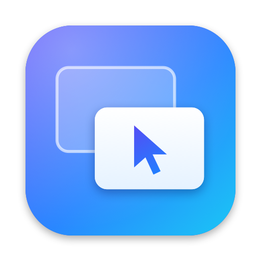
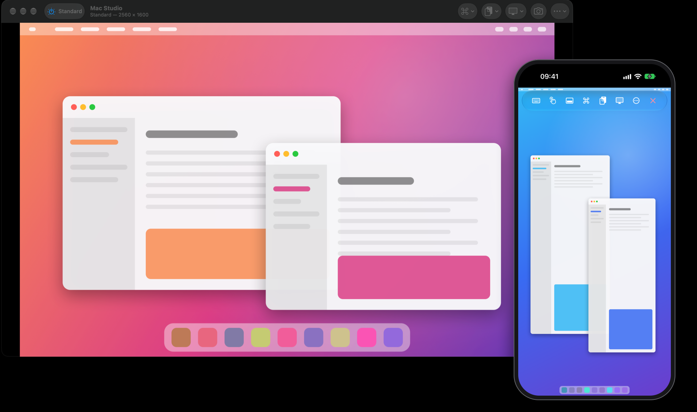

<div align="center">



# OpenScreens

**Remote desktop for Mac, iPhone and iPad. Free and open source.**

Control a Mac the way Apple's own Screen Sharing does — High Performance mode,
sound and a desktop that resizes to fit included — or any computer that speaks
VNC.

[](https://github.com/burakgon/OpenScreens/actions/workflows/ci.yml)
[](https://github.com/burakgon/OpenScreens/releases/latest)


[](LICENSE)



</div>

## What it does

**The picture**

- **High Performance mode** for Apple silicon Macs: HEVC video at up to 60
  frames a second, the remote Mac's sound, and a desktop created at the size
  of your window or screen — a phone held upright gets an upright desktop.
- **One display, all of them side by side, or two virtual displays** of your
  own.
- **Standard and Full Quality** modes for every Mac, and for Windows, Linux
  and Raspberry Pi computers running a VNC server.
- Zoom, pan, fit, fill and actual size. A reconnect picks up where it left
  off, with the last picture still faintly there.

**The keyboard and pointer**

- **What you type is what arrives**, whichever keyboard layouts the two
  computers use. On a Turkish, German or French keyboard the symbols behind
  Option — `@ # { } [ ] \` — come out as those symbols, dead keys combine,
  and shortcuts land on the key they name. Prefer the remote layout to
  decide? Send key positions instead, as Apple's client does.
- Keystrokes to a Mac are encrypted, even in a session whose picture is not.
- On iPhone and iPad: touch the thing you want to click, or use the screen as
  a trackpad. Two-finger scrolling with momentum, pinch to zoom, right-click
  and drag gestures, a key bar for modifiers, arrows and function keys, and
  full support for hardware keyboards, trackpads, mice and Apple Pencil.
- Shortcuts in one tap — Mission Control, Spotlight, Control-Alt-Delete — and
  your own. Type Text sends a whole paragraph as keystrokes.

**Getting there**

- **Nearby** finds the computers on your network that offer screen sharing.
- **Tailscale** lists the computers in your tailnet, so they are one tap away
  from anywhere.
- **SSH tunnels** carry the whole connection inside SSH, with a password or a
  key. A server's key is shown before it is trusted, and a changed key stops
  the connection.
- **Wake-on-LAN** wakes a sleeping computer first (from the Mac app).
- `vnc://` links, a menu bar item on the Mac, and actions for Shortcuts.

**Your library**

- Groups, tags, favourites, recents and search, as a grid of screen previews
  or a list.
- **iCloud sync** keeps it the same on every device. Passwords stay in your
  keychain and never go into the library file, iCloud's copy of it or a
  backup.
- Daily automatic backups, export and import.
- Lock the app behind Face ID or Touch ID.

**While connected**

- Shared clipboard. Curtain mode, which blanks the remote Mac's own screen
  while you work. Observe only. Lock the remote Mac when you disconnect.
- Live statistics: mode, size, frame rate, bitrate, loss, and how the
  connection is protected.

## Install

**Mac** — download the latest `OpenScreens.dmg` from
[Releases](https://github.com/burakgon/OpenScreens/releases/latest), open it
and drag OpenScreens to Applications. The app is signed with a Developer ID
and notarised by Apple. Requires macOS 26 or later.

**iPhone and iPad** — a TestFlight beta is running; until it is opened to
everyone, [build it yourself](#building-from-source). Requires iOS or iPadOS
26 or later.

## Getting started

On the Mac you want to control, open **System Settings › General › Sharing**
and turn on **Screen Sharing**. For High Performance mode that Mac needs
Apple silicon and macOS 14 or later.

In OpenScreens, pick the Mac from **Nearby**, or choose **Add Computer** and
type its name or address. Sign in with your account on that Mac.

For a PC or a Raspberry Pi, set up a VNC server on it and add the computer
the same way.

### From outside your network

Screen sharing is not something to expose to the internet. Two good ways to
reach a computer from elsewhere:

- **Tailscale.** Install it on both ends and connect to the computer's
  tailnet name. Everything travels inside WireGuard.
- **An SSH tunnel.** Turn on **Remote Login** next to Screen Sharing, then in
  the computer's settings switch on **Connect Through SSH**. Nothing but SSH
  has to be reachable. High Performance mode sends its picture over UDP, which
  a tunnel does not carry, so a tunnelled session runs in Standard.

## How a session is protected

| | Sign-in | Keystrokes | Picture, clipboard and sound |
|---|---|---|---|
| Mac, High Performance | Encrypted | Encrypted | Encrypted (AES, with SRTP for video and sound) |
| Mac, Standard or Full Quality | Encrypted | Encrypted | **Not encrypted** |
| Any computer through an SSH tunnel | Encrypted | Encrypted | Encrypted |
| VNC server with a VNC password | Challenge–response | Not encrypted | Not encrypted |

On your own network that is usually fine. Across networks you do not control,
use Tailscale or an SSH tunnel. The statistics overlay always says which of
these a session is.

## Building from source

You need Xcode 27.2 or later on macOS 26 or later.

```sh
git clone https://github.com/burakgon/OpenScreens.git
cd OpenScreens
cp Config/Signing.example.xcconfig Config/Signing.xcconfig   # then set your team
open OpenScreens.xcodeproj
```

Choose the **OpenScreens** scheme for the Mac or **OpenScreens iOS** for
iPhone and iPad, and run. Building for a simulator needs no team at all.

The Xcode project is generated from [`project.yml`](project.yml) with
[XcodeGen](https://github.com/yonaskolb/XcodeGen) and checked in, so you only
need XcodeGen if you change the project's structure.

### Tests

```sh
swift test --package-path Packages/OpenScreensKit
```

runs the unit tests and the end-to-end tests, which connect a real session to
a small screen-sharing server on loopback. The SSH tests start a private,
unprivileged `sshd` and skip themselves where that is not possible. The
interface tests drive the iPhone app with touches and key presses:

```sh
xcodebuild test -project OpenScreens.xcodeproj -scheme "OpenScreens iOS" \
  -destination "platform=iOS Simulator,name=iPhone 18 Pro"
```

No computer to connect to? `swift run --package-path Packages/OpenScreensKit
openscreens-demo-server` shows a drawn desktop on port 5900.

## How it is put together

```
Apps/                    Thin app targets for macOS and iOS
Packages/OpenScreensKit/
  OpenScreensCore        Library, sync, discovery, SSH, key translation — no UI
  OpenScreensUI          SwiftUI interface, session controller, the two canvases
  RFBTestServer          A tiny screen-sharing server for tests and demos
Vendor/rootshell-vnc     The protocol engine, with local changes as commits
```

[docs/ARCHITECTURE.md](docs/ARCHITECTURE.md) walks through it, and
[docs/apple-screen-sharing-notes.md](docs/apple-screen-sharing-notes.md)
records what was learned about Apple's protocol along the way.

## Known limits

- Choosing between the Mac's login window and a user's own session is not
  supported; a connection is always to the session the Mac offers.
- Emoji and other characters outside Unicode's basic plane cannot be typed
  into a Mac as keystrokes. Paste them instead.
- An SSH server that only offers an RSA host key, or only
  keyboard-interactive sign-in, is not supported.
- A VNC server that insists on TLS with a self-signed certificate is not
  supported yet. Tunnel through SSH instead.

## Contributing

Bug reports, ideas and pull requests are welcome — see
[CONTRIBUTING.md](CONTRIBUTING.md). Security problems go through
[SECURITY.md](SECURITY.md), not the issue tracker.

## Acknowledgements

OpenScreens stands on [rootshellVNC](https://github.com/kitknox/rootshell-vnc)
by Kit Knox, which implements RFB and Apple's Screen Sharing extensions, and
on [SwiftNIO](https://github.com/apple/swift-nio) and
[SwiftNIO SSH](https://github.com/apple/swift-nio-ssh) from Apple and
[BigInt](https://github.com/attaswift/BigInt) by Károly Lőrentey.

## License

[MIT](LICENSE). OpenScreens is an independent project. It is not affiliated
with, or endorsed by, Apple or any maker of remote-desktop software. Mac,
iPhone, iPad and macOS are trademarks of Apple Inc.
